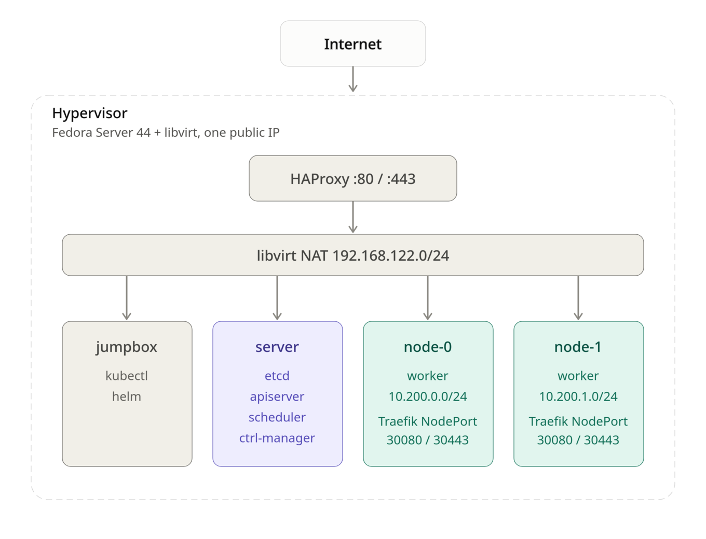

This post is a short write-up of how I built a Kubernetes cluster by hand, following [Kubernetes The Hard Way](https://github.com/kelseyhightower/kubernetes-the-hard-way) by **Kelsey Hightower** in its Rocky Linux adaptation by **Wale Soyinka**.

The Rocky Linux labs target Enterprise Linux on x86_64. I used Fedora Server 44 instead, with all the machines running as libvirt VMs on a single hypervisor that has only one public IP. Then I went further than the labs: cluster DNS, Argo CD, and public HTTPS access for apps.

### Architecture

{ width="80%" }

| VM | Role |
|---|---|
| `jumpbox` | Admin machine: `kubectl`, `helm`, certificates and configs |
| `server` | Control plane: etcd, kube-apiserver, kube-controller-manager, kube-scheduler |
| `node-0`, `node-1` | Workers: containerd, kubelet, kube-proxy |


| Network | Range |
|---|---|
| Pod network node-0 | `10.200.0.0/24` |
| Pod network node-1 | `10.200.1.0/24` |
| Services | `10.32.0.0/24` (API `10.32.0.1`, DNS `10.32.0.10`) |

### **Prerequisites**

1. A host running [Fedora Server](https://fedoraproject.org/server/) with virtualization enabled
2. [libvirt](https://libvirt.org/) with `virt-install` and `virsh`
3. A Fedora Server 44 install image for the VMs
4. Optional, for public access: a domain name pointing to the hypervisor's public IP

Install the virtualization stack on the host:

```
$ sudo dnf install -y @virtualization
$ sudo systemctl enable --now libvirtd
```

---

I created four VMs on the default libvirt NAT network. An example for one machine (adapt CPU, memory, disk and image path):

```
$ sudo virt-install \
    --name node-0 \
    --vcpus 2 --memory 4096 \
    --disk size=20 \
    --os-variant fedora-44 \
    --network network=default \
    --location /var/lib/libvirt/images/Fedora-Server-dvd-x86_64-44.iso \
    --graphics none --extra-args 'console=ttyS0'
```

Once all four are installed:

```
$ sudo virsh list --all
 Id   Name      State
-------------------------
 2    server    running
 3    jumpbox   running
 4    node-0    running
 5    node-1    running
```


---

---

### **Following the labs**

I followed the Rocky Linux labs in order. Most commands work unchanged on Fedora since both use dnf, systemd and NetworkManager.

1. [Prerequisites](https://docs.rockylinux.org/10/labs/kubernetes-the-hard-way/lab1-prerequisites/)
2. [Set Up The Jumpbox](https://docs.rockylinux.org/10/labs/kubernetes-the-hard-way/lab2-jumpbox/)
3. [Provisioning Compute Resources](https://docs.rockylinux.org/10/labs/kubernetes-the-hard-way/lab3-compute-resources/)
4. [Provisioning a CA and Generating TLS Certificates](https://docs.rockylinux.org/10/labs/kubernetes-the-hard-way/lab4-certificate-authority/)
5. [Generating Kubernetes Configuration Files for Authentication](https://docs.rockylinux.org/10/labs/kubernetes-the-hard-way/lab5-kubernetes-configuration-files/)
6. [Generating the Data Encryption Configuration and Key](https://docs.rockylinux.org/10/labs/kubernetes-the-hard-way/lab6-data-encryption-keys/)
7. [Bootstrapping the etcd Cluster](https://docs.rockylinux.org/10/labs/kubernetes-the-hard-way/lab7-bootstrapping-etcd/)
8. [Bootstrapping the Kubernetes Control Plane](https://docs.rockylinux.org/10/labs/kubernetes-the-hard-way/lab8-bootstrapping-kubernetes-controllers/)
9. [Bootstrapping the Kubernetes Worker Nodes](https://docs.rockylinux.org/10/labs/kubernetes-the-hard-way/lab9-bootstrapping-kubernetes-workers/)
10. [Configuring kubectl for Remote Access](https://docs.rockylinux.org/10/labs/kubernetes-the-hard-way/lab10-configuring-kubectl/)
11. [Provisioning Pod Network Routes](https://docs.rockylinux.org/10/labs/kubernetes-the-hard-way/lab11-pod-network-routes/)
12. [Smoke Test](https://docs.rockylinux.org/10/labs/kubernetes-the-hard-way/lab12-smoke-test/)

At the end the smoke test passes: deployments, port-forward, logs, exec and NodePort services all work. But the cluster is still bare, and a few things bit me as soon as I tried to install a real application.

---

#### **Lesson 1: check the pod routes on every machine**

Lab 11 adds static routes so each machine can reach the other workers' pods. Mine were incomplete: `server` only had a route to node-0's pods, and the two workers had no route to each other. The smoke test doesn't catch this because it only uses one pod.

Every machine needs a route to every *other* worker's pod network:

```
$ ssh root@server 'ip route | grep 10.200'
10.200.0.0/24 via <node-0 IP> dev enp1s0
10.200.1.0/24 via <node-1 IP> dev enp1s0

$ ssh root@node-0 'ip route | grep 10.200'
10.200.0.0/24 dev cni0 proto kernel scope link src 10.200.0.1
10.200.1.0/24 via <node-1 IP> dev enp1s0
```

`ip route add` is lost at reboot. On Fedora, make sure the routes are permanent with NetworkManager:

```
$ nmcli -g NAME,DEVICE con show --active
$ sudo nmcli con modify '<connection>' +ipv4.routes '10.200.1.0/24 <node-1 IP>'
$ sudo nmcli con up '<connection>'
```

> **Note:**
> A missing route shows up later as random timeouts: DNS that works on one node only, webhooks that time out, certificates that never get issued. Check routes first.

---

#### **Lesson 2: the cluster has no DNS**

The labs don't install a DNS add-on, so pods can't resolve service names. Almost every real app needs it :( . I installed [CoreDNS](https://coredns.io/) with Helm from the jumpbox, on the IP the kubelets give pods as their DNS server (clusterDNS in the kubelet config):

```
$ ssh root@node-0 grep -A1 clusterDNS /var/lib/kubelet/kubelet-config.yaml
```

The first attempt crash-looped with `plugin/loop: Loop ... detected`: and the nodes `/etc/resolv.conf` points to a local resolver, so CoreDNS was forwarding queries to itself. The fix is to give it real upstream servers in a values file, `coredns-values.yaml`:

```yaml
replicaCount: 2
service:
  clusterIP: 10.32.0.10
servers:
- zones:
  - zone: .
    use_tcp: true
  port: 53
  plugins:
  - name: errors
  - name: health
    configBlock: |-
      lameduck 10s
  - name: ready
  - name: kubernetes
    parameters: cluster.local in-addr.arpa ip6.arpa
    configBlock: |-
      pods insecure
      fallthrough in-addr.arpa ip6.arpa
      ttl 30
  - name: prometheus
    parameters: 0.0.0.0:9153
  - name: forward
    parameters: . 1.1.1.1 8.8.8.8
  - name: cache
    parameters: 30
  - name: loop
  - name: reload
  - name: loadbalance
```

```
$ helm repo add coredns https://coredns.github.io/helm
$ helm upgrade --install coredns coredns/coredns -n kube-system -f coredns-values.yaml
```

Test from a pod:

```
$ kubectl run dnstest --rm -it --image=busybox:1.36 --restart=Never -- \
    sh -c 'nslookup kubernetes.default.svc.cluster.local; nslookup github.com'
```

---

#### **Lesson 3: the control plane can't reach Services**

The `server` machine runs no kube-proxy, so the API server can't reach Service IPs. That breaks anything with an admission webhook, such as cert-manager (`failed calling webhook ... context deadline exceeded`).

The fix is one flag in `/etc/systemd/system/kube-apiserver.service` on `server`, which makes the API server call webhook pods by their pod IPs (reachable thanks to the routes from lesson 1):

```
  --enable-aggregator-routing=true \
```

```
$ sudo systemctl daemon-reload && sudo systemctl restart kube-apiserver
```

---


### **Deploying Argo CD**

[Argo CD](https://argo-cd.readthedocs.io/) runs fine on this cluster once DNS works. It needs no persistent storage.

```
$ kubectl create namespace argocd
$ kubectl apply -n argocd --server-side --force-conflicts \
    -f https://raw.githubusercontent.com/argoproj/argo-cd/stable/manifests/install.yaml
$ kubectl -n argocd get pods -w
```

Get the initial admin password:

```
$ kubectl -n argocd get secret argocd-initial-admin-secret \
    -o jsonpath='{.data.password}' | base64 -d; echo
```


### **Exposing apps with a single public ip**


Only the hypervisor is reachable from the internet, and there is no cloud LoadBalancer.  
My setup :"

- Traefik as ingress controller, exposed as a NodePort on 30080 / 30443.
- HAProxy on the hypervisor, passing TCP 80 / 443 to those nodeports.
- cert-manager with let's encrypt for TLS.
- One DNS record per app pointing to the public ip .


1. Traefik

```  
$ helm repo add traefik https://traefik.github.io/charts
$ helm install traefik traefik/traefik -n traefik --create-namespace \
    --set service.type=NodePort \
    --set ports.web.nodePort=30080 \
    --set ports.websecure.nodePort=30443 \
    --set deployment.replicas=2 \
    --set ingressClass.isDefaultClass=true  
``` 

2. HAproxy (on the hypervisor) 

Added to `/etc/haproxy/haproxy.cfg`
```  
frontend http_in
    bind *:80
    mode tcp
    default_backend k8s_http

frontend https_in
    bind *:443
    mode tcp
    default_backend k8s_https

backend k8s_http
    mode tcp
    balance roundrobin
    server node0 <node-0 IP>:30080 check
    server node1 <node-1 IP>:30080 check

backend k8s_https
    mode tcp
    balance roundrobin
    server node0 <node-0 IP>:30443 check
    server node1 <node-1 IP>:30443 check
```


```
$ sudo setsebool -P haproxy_connect_any 1
$ sudo firewall-cmd --permanent --add-service=http --add-service=https
$ sudo firewall-cmd --reload
$ sudo systemctl enable --now haproxy
```

3. cert-manager and let's encryt

```
$ sudo setsebool -P haproxy_connect_any 1
$ sudo firewall-cmd --permanent --add-service=http --add-service=https
$ sudo firewall-cmd --reload
$ sudo systemctl enable --now haproxy
```

`issuers.yaml` : 

```
apiVersion: cert-manager.io/v1
kind: ClusterIssuer
metadata:
  name: letsencrypt-prod
spec:
  acme:
    server: https://acme-v02.api.letsencrypt.org/directory
    email: <your email>
    privateKeySecretRef:
      name: letsencrypt-prod-key
    solvers:
      - http01:
          ingress:
            ingressClassName: traefik
```

4. ArgoCD over HTTPS

Traefik terminates TLS, so ArgoCD serves plain HTTP behind it: 

```
$ kubectl -n argocd patch configmap argocd-cmd-params-cm --type merge \
    -p '{"data":{"server.insecure":"true"}}'
$ kubectl -n argocd rollout restart deployment argocd-server
```

```
apiVersion: networking.k8s.io/v1
kind: Ingress
metadata:
  name: argocd-server
  namespace: argocd
  annotations:
    cert-manager.io/cluster-issuer: letsencrypt-prod
spec:
  ingressClassName: traefik
  tls:
    - hosts: [argocd.<your-domain>]
      secretName: argocd-server-tls
  rules:
    - host: argocd.<your-domain>
      http:
        paths:
          - path: /
            pathType: Prefix
            backend:
              service:
                name: argocd-server
                port:
                  number: 80
```

```
$ kubectl get certificate -n argocd
$ argocd login argocd.<your-domain> --grpc-web --username admin
```

Argo CD is now reachable at https://argocd.<your-domain> with a valid certificate.


### References

- [Kubernetes The Hard Way](https://github.com/kelseyhightower/kubernetes-the-hard-way), Kelsey Hightower
- [Kubernetes The Hard Way, Rocky Linux edition](https://docs.rockylinux.org/10/labs/kubernetes-the-hard-way/lab0-README/), Wale Soyinka
- [CoreDNS Helm chart](https://github.com/coredns/helm)
- [Argo CD documentation](https://argo-cd.readthedocs.io/)
- [Traefik Helm chart](https://github.com/traefik/traefik-helm-chart)
- [cert-manager documentation](https://cert-manager.io/docs/)